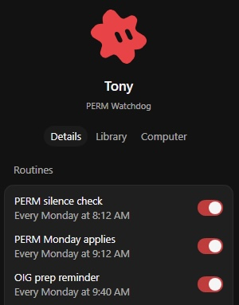

# Become an Operator

## 1. What an operator is

**Operator — configuration and execution.**

An operator sets things up and gets them done. That holds whether the work runs through a person or through a bot. The operator owns both seats: the human seat and the bot seat. Any bot stands up only under the operator who will review its output against the Light Tetrad and the American System filter. However much a bot does, the operator remains the accountable human.

## 2. How an operator behaves

Operators work from four behaviors, the Light Tetrad:

- **Curiosity**
- **Accountability/Forgiveness**
- **Kindness as Truth**
- **Preserving and Elevating Life**

Read the full overlay here: [digitalknowledge.net/overlay](https://digitalknowledge.net/overlay)

## 3. The training path

Training comes as the BMC kits M1-M5, shown as cards in section 4 below. To start, pick a kit card or get in touch (section 5).

### Training drives capability: Tony

Tony is my PERM Watch bot. A PERM ad is a job ad an employer must run before sponsoring a foreign worker for a green card. Today Tony finds PERM ads through jobs.now. The next version reads free newspaper classifieds, with release planned for late November. More in my post: ["What's next for Tony, my PERM Watch bot"](https://x.com/7SwanSwimming/status/2115921149527797890).

### Applying capability drives capacity: John (IT / SI administrator), coming on board

John's seat shows how an operator puts capability to work safely:

- **Least access.** He gets only what the job needs.
- **Read-only first job.** The first task looks, it doesn't change.
- **Draft-only work.** Nothing is final without a QA check and the owner's typed yes.
- **Never print secrets.**

## 4. What you can buy

One section, one card per product. Each card links straight to its buy page.

### BMC kits M1-M5

Sellable self-serve kits, each with SI walkthroughs.

**BMC Module 1 Implementation Kit: Business Model Canvas**  
Capacity redesign under productive-sovereignty filter.  
[Buy](https://store.digitalknowledge.net/l/bmc-module-1-implementation-kit)

**BMC Module 2 Implementation Kit: OKRs**  
Objectives & key results that compound capacity.  
[Buy](https://store.digitalknowledge.net/l/bmc-module-2-implementation-kit)

**BMC Module 3 Implementation Kit: Operating Model**  
How the work actually runs under the filter.  
[Buy](https://store.digitalknowledge.net/l/bmc-module-3-implementation-kit)

**BMC Module 4 Implementation Kit: Value Streams / Lean**  
Flow and waste under productive strength.  
[Buy](https://store.digitalknowledge.net/l/bmc-module-4-implementation-kit)

**BMC Module 5 Implementation Kit: Workforce Strategy**  
Critical seats & citizen capacity.  
[Buy](https://store.digitalknowledge.net/l/bmc-module-5-implementation-kit)

### Pop-Up store

**American System Yard Sign**  
[Buy](https://digitalknowledge.printify.me/product/33504901)

**HLT + AS Yard Sign (two-sided)**  
[Buy](https://digitalknowledge.printify.me/product/33504900)

**Hamilton Lincoln Trump Yard Sign**  
[Buy](https://digitalknowledge.printify.me/product/33504902)

**Found like Hamilton, Unite like Lincoln, Grow like Trump**  
[Buy](https://digitalknowledge.printify.me/product/33504908)

**Found like Hamilton, Unite like Lincoln, Grow like Trump (Navy)**  
[Buy](https://digitalknowledge.printify.me/product/33604800)

**American System Tee: Capacity 420**  
[Buy](https://digitalknowledge.printify.me/product/33504906)

**Found Like Hamilton, Unite Like Lincoln, Grow Like Trump iPhone 16 Pro Max Case (DK)**  
[Buy](https://digitalknowledge.printify.me/product/33652372)

### Bot

**Tony, the PERM Watch Bot**  
  
Tony finds PERM ads and drafts the applications. It waits for your one OK before sending anything.  
[Get Tony](https://x.ai/bot/g0SYDSP-RNIQBp31kMKEK) · ["What's next for Tony, my PERM Watch bot"](https://x.com/7SwanSwimming/status/2115921149527797890)

## 5. Get in touch

X [@7SwanSwimming](https://x.com/7SwanSwimming) or [joshua@digitalknowledge.net](mailto:joshua@digitalknowledge.net).
